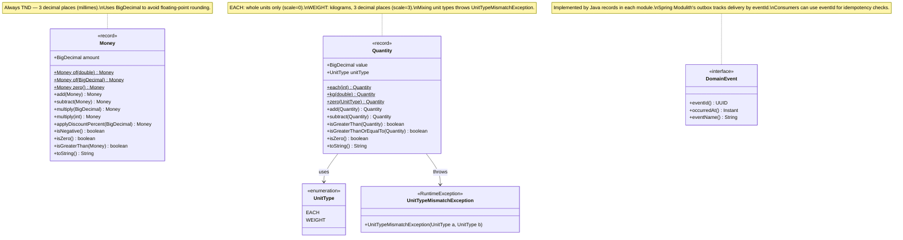

# Class Diagram — `shared` Module

The `shared` module contains the cross-cutting value objects and the domain-event contract.  
Every other module depends on `shared`; `shared` depends on nothing.

## Notes

| Type | Kind | Key constraint |
|---|---|---|
| `Money` | Java `record` (immutable) | Always TND, always 3 dp, never negative in financial writes |
| `Quantity` | Java `record` + `@Embeddable` | `EACH` must be a whole number; `WEIGHT` is 3 dp kilograms |
| `UnitType` | Inner `enum` of `Quantity` | Used everywhere a unit type is stored (product, lot, transaction line, order line) |
| `DomainEvent` | Interface | All cross-module events implement this; Spring Modulith persists them via the JDBC outbox |
