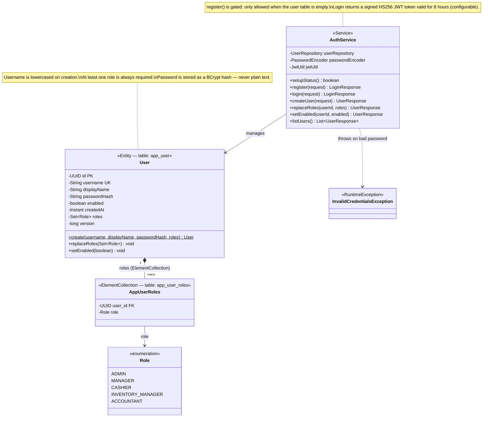

# Class Diagram — `auth` Module

The `auth` module owns user accounts, password hashing, JWT issuance, and role management.  
It exposes a one-time first-admin setup flow; after that, only `ADMIN` users can create or modify accounts.

## Enumerations

| Value | Description |
|---|---|
| `ADMIN` | Full system access, including user management |
| `MANAGER` | All business modules except Users |
| `CASHIER` | Dashboard and POS only |
| `INVENTORY_MANAGER` | Dashboard, Inventory, Pricing, Procurement |
| `ACCOUNTANT` | Dashboard and Finance only |

## Key behaviours

- **First-admin setup** — `register()` is only accepted when `app_user` is empty. The first account always receives `ADMIN`.
- **Subsequent users** — created by `ADMIN` through `POST /api/auth/users`; roles are set at creation time.
- **JWT** — HS256, signed with `JWT_SECRET`, carries the `roles` claim, valid for `JWT_EXPIRATION_SECONDS` (default 8 h). Role changes take effect on the next login.
- **Optimistic locking** — `version` column prevents concurrent role/enabled changes.
