# Class Diagram — `inventory` Module

The `inventory` module owns the product catalog, product families, lot-based FEFO stock levels, and all stock movement events.  
`StockLevel` is the aggregate root — no external code touches a `Lot` or `LotEntry` directly.

```mermaid
classDiagram

    %% ── Product Catalog ────────────────────────────────────────
    class ProductFamily {
        <<Entity — table: inventory.product_family>>
        -UUID id PK
        -String name UK
        -String imageUrl
        +create(name, imageUrl) ProductFamily$
    }
    note for ProductFamily "Groups product variants (e.g. 'Water' contains Safia 1.5L, Sabrine 1.5L).\nEach variant is a separate Product with its own SKU, stock, and price."

    class Product {
        <<Entity — table: inventory.product>>
        -UUID id PK
        -String sku UK
        -String name
        -ProductFamily family
        -String imageUrl
        -UnitType unitType
        -boolean perishable
        -int reorderPoint
        -BigDecimal vatRate
        +create(sku, name, unitType, perishable, reorderPoint) Product$
        +create(sku, name, unitType, perishable, reorderPoint, vatRate) Product$
        +create(sku, name, family, imageUrl, unitType, perishable, reorderPoint, vatRate) Product$
    }
    note for Product "vatRate defaults to 19% if omitted.\nreorderPoint must be >= 0.\nfamilyId is optional — standalone products are allowed."

    %% ── Stock Aggregate ────────────────────────────────────────
    class StockLevel {
        <<Entity — table: inventory.stock_level — AGGREGATE ROOT>>
        -UUID id PK
        -UUID productId UK
        -List~LotEntry~ lots
        -long version
        +initialize(productId) StockLevel$
        +receive(lot, quantity) void
        +sell(quantityToSell, today, reorderPoint) Money
        +reserve(quantity) void
        +writeOff(lotId, quantity, reason, reorderPoint) void
        +domainEvents() List~DomainEvent~
        +clearDomainEvents() void
    }
    note for StockLevel "FEFO: sell() deducts from the lot that expires soonest first.\nPublishes StockReceived, StockSold, StockWrittenOff, LowStockThresholdReached.\nOptimistic locking (version) prevents double-deduction in concurrent sales."

    class LotEntry {
        <<Entity — table: inventory.lot_entry — owned by StockLevel>>
        -UUID id PK
        -Lot lot
        -Quantity onHand
        -Quantity reserved
        +available() Quantity
        +deductUpTo(Quantity) Quantity
        +deduct(Quantity) void
        +reserve(Quantity) Quantity
        +costFor(Quantity) Money
    }
    note for LotEntry "Package-private — only StockLevel can create or modify it.\navailable = onHand - reserved"

    class Lot {
        <<Entity — table: inventory.lot — owned by LotEntry>>
        -UUID id PK
        -String lotNumber
        -UUID productId
        -LocalDate expiryDate
        -LocalDate receivedDate
        -String supplierReference
        -Money unitCost
        +receive(lotNumber, productId, expiryDate, receivedDate, supplierReference) Lot$
        +receive(lotNumber, productId, expiryDate, receivedDate, supplierReference, unitCost) Lot$
        +daysUntilExpiry(LocalDate) long
        +isExpired(LocalDate) boolean
        +isPerishable() boolean
    }
    note for Lot "expiryDate is null for non-perishables.\ndaysUntilExpiry returns Long.MAX_VALUE for non-perishables (sorts last in FEFO)."

    %% ── Domain Events ──────────────────────────────────────────
    class StockReceived {
        <<record — DomainEvent>>
        +UUID eventId
        +Instant occurredAt
        +UUID productId
        +UUID lotId
        +Quantity quantity
        +of(productId, lotId, quantity) StockReceived$
    }

    class StockSold {
        <<record — DomainEvent>>
        +UUID eventId
        +Instant occurredAt
        +UUID productId
        +Quantity quantity
        +of(productId, quantity) StockSold$
    }

    class StockWrittenOff {
        <<record — DomainEvent>>
        +UUID eventId
        +Instant occurredAt
        +UUID productId
        +UUID lotId
        +Quantity quantity
        +String reason
        +of(productId, lotId, quantity, reason) StockWrittenOff$
    }

    class LowStockThresholdReached {
        <<record — DomainEvent>>
        +UUID eventId
        +Instant occurredAt
        +UUID productId
        +of(productId) LowStockThresholdReached$
    }
    note for LowStockThresholdReached "Published when on-hand drops at or below reorderPoint.\nConsumed by Procurement to create a LowStockAlert."

    %% ── Exception ──────────────────────────────────────────────
    class InsufficientStockException {
        <<RuntimeException>>
        +InsufficientStockException(productId, requested, available)
    }

    %% ── Relationships ──────────────────────────────────────────
    ProductFamily "1" <-- "many" Product : family (optional ManyToOne)
    StockLevel "1" *-- "many" LotEntry : lots (OneToMany, cascade ALL)
    LotEntry "1" *-- "1" Lot : lot (OneToOne, cascade ALL)
    StockLevel ..> StockReceived : publishes
    StockLevel ..> StockSold : publishes
    StockLevel ..> StockWrittenOff : publishes
    StockLevel ..> LowStockThresholdReached : publishes
    StockLevel ..> InsufficientStockException : throws
```

## Aggregate rules

| Rule | Detail |
|---|---|
| **FEFO ordering** | `sell()` and `reserve()` always deduct from the `LotEntry` whose `Lot.expiryDate` is earliest. Non-perishables sort last. |
| **Reorder check** | After every `sell()` and `writeOff()`, the aggregate compares total available against `reorderPoint` and publishes `LowStockThresholdReached` if at or below the threshold. |
| **Optimistic lock** | `StockLevel.version` prevents two concurrent sales from deducting the same stock without conflict. |
| **Event lifecycle** | Domain events are stored in a `@Transient` list. `InventoryService` publishes them and calls `clearDomainEvents()` in the same transaction. |
| **Unit consistency** | Mixing `EACH` and `WEIGHT` quantities throws `UnitTypeMismatchException` from `Quantity`. |
