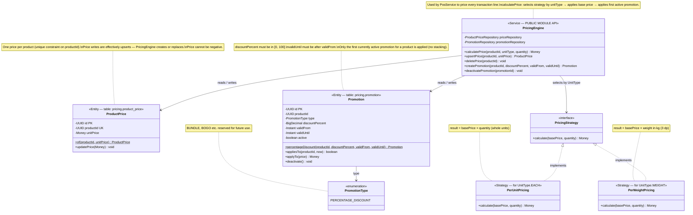

# Class Diagram — `pricing` Module

The `pricing` module owns product base prices and time-bounded percentage promotions.  
`PricingEngine` is the **only public API** consumed by other modules (specifically POS).



## Pricing calculation flow

```
PricingEngine.calculatePrice(productId, unitType, quantity)
  │
  ├─ 1. Load ProductPrice → basePrice (Money)
  ├─ 2. Select strategy: UnitType.EACH → PerUnitPricing
  │                       UnitType.WEIGHT → PerWeightPricing
  ├─ 3. linePrice = strategy.calculate(basePrice, quantity)
  └─ 4. Find first active Promotion for productId at Instant.now()
           → if found: linePrice = promotion.applyTo(linePrice)
           → return linePrice (VAT-exclusive)
```

## Key constraints

| Constraint | Detail |
|---|---|
| One price per product | `productId` has a `UNIQUE` constraint on `product_price` |
| Non-negative price | `ProductPrice.of()` rejects negative `unitPrice` |
| Valid promotion window | `validUntil` must be strictly after `validFrom` |
| Single promotion | Only the **first** currently active promotion is applied; promotions do not stack |
| No price → error | `calculatePrice()` throws if no `ProductPrice` exists for the product |
