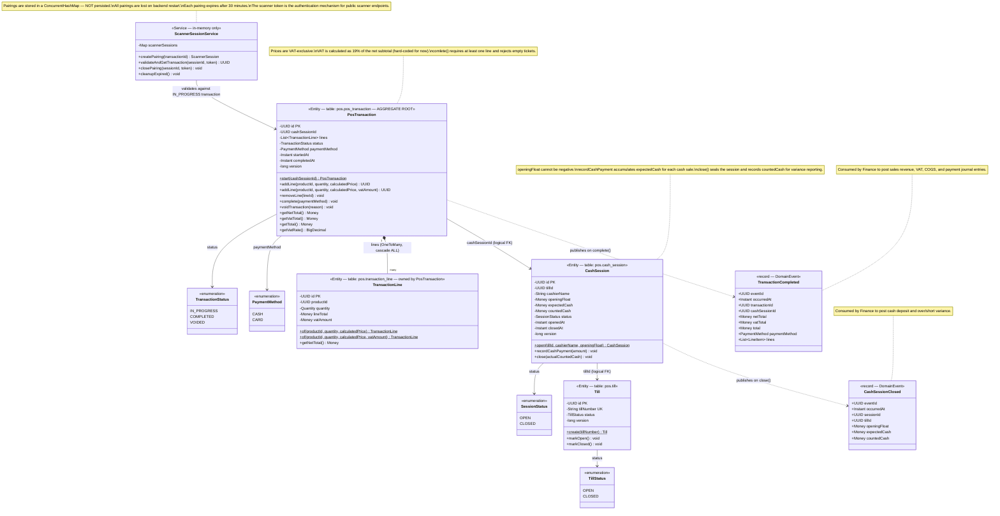

# Class Diagram — `pos` Module

The `pos` module owns tills, cashier sessions, sale transactions, and the phone-scanner QR pairing.  
`PosTransaction` is the central aggregate: it owns `TransactionLine` items and enforces the sale state machine.



## State machines

### Till status
```
CLOSED ──markOpen()──▶ OPEN
OPEN ──markClosed()──▶ CLOSED
```

### CashSession status
```
(created) ──open()──▶ OPEN ──close()──▶ CLOSED
```

### PosTransaction status
```
(created) ──start()──▶ IN_PROGRESS ──complete()──▶ COMPLETED
                             │
                             └──voidTransaction()──▶ VOIDED
```

## Key sale flow

1. `PosService.startTransaction(cashSessionId)` — creates an `IN_PROGRESS` transaction.
2. `addLine(productId, quantity)` — calls `PricingEngine.calculatePrice()`, then adds a `TransactionLine`.
3. `complete(paymentMethod, amountReceived)`:
   - Validates payment (cash ≥ total; card = total exactly).
   - Calls `InventoryService.sell()` for every line (FEFO deduction).
   - Calls `CashSession.recordCashPayment()` for CASH payments.
   - Transitions to `COMPLETED` and publishes `TransactionCompleted`.
4. Finance consumes `TransactionCompleted` and posts the balanced journal entry.

> **Stock and transaction completion are in the same Spring transaction** — insufficient stock rolls back the entire sale.
