# Class Diagram — `procurement` Module

The `procurement` module owns suppliers, purchase orders, goods receipt, and low-stock alerts.  
`PurchaseOrder` is the aggregate root: it owns `PurchaseOrderLine` items and enforces the order state machine.

```mermaid
classDiagram

    %% ── Supplier ───────────────────────────────────────────────
    class Supplier {
        <<Entity — table: procurement.supplier>>
        -UUID id PK
        -String name
        -String contactPhone
        -String contactEmail
        +create(name, contactPhone, contactEmail) Supplier$
    }
    note for Supplier "address is accepted by the DTO but not yet persisted by the domain model."

    %% ── Purchase Order Aggregate ───────────────────────────────
    class PurchaseOrder {
        <<Entity — table: procurement.purchase_order — AGGREGATE ROOT>>
        -UUID id PK
        -UUID supplierId
        -List~PurchaseOrderLine~ lines
        -PurchaseOrderStatus status
        -Instant placedAt
        +draft(supplierId) PurchaseOrder$
        +addLine(productId, quantity, unitCost) void
        +place() void
        +cancel() void
        +markReceived(receiptLines) void
        +domainEvents() List~DomainEvent~
        +clearDomainEvents() void
    }
    note for PurchaseOrder "addLine() only allowed in DRAFT status.\nplace() requires at least one line.\nmarkReceived() requires PLACED status and publishes GoodsReceived.\ncancel() clears any pending domain events."

    class PurchaseOrderLine {
        <<Entity — table: procurement.purchase_order_line — owned by PurchaseOrder>>
        -UUID id PK
        -UUID productId
        -Quantity quantity
        -Money unitCost
        +of(productId, quantity, unitCost) PurchaseOrderLine$
    }
    note for PurchaseOrderLine "unitCost cannot be negative.\nDeliberately a separate type from TransactionLine (POS) — same structure, different meaning."

    class PurchaseOrderStatus {
        <<enumeration>>
        DRAFT
        PLACED
        RECEIVED
        CANCELLED
    }

    %% ── Low Stock Alert ────────────────────────────────────────
    class LowStockAlert {
        <<Entity — table: procurement.low_stock_alert>>
        -UUID id PK
        -UUID productId
        -Instant raisedAt
        -boolean acknowledged
        +raise(productId) LowStockAlert$
        +acknowledge() void
    }
    note for LowStockAlert "Created by LowStockThresholdReachedListener when Inventory publishes the event.\nThe manager acknowledges alerts manually — no automatic PO creation."

    %% ── Domain Events ──────────────────────────────────────────
    class PurchaseOrderPlaced {
        <<record — DomainEvent>>
        +UUID eventId
        +Instant occurredAt
        +UUID orderId
        +UUID supplierId
        +List~LineItem~ lines
        +of(orderId, supplierId, lines) PurchaseOrderPlaced$
    }

    class GoodsReceived {
        <<record — DomainEvent>>
        +UUID eventId
        +Instant occurredAt
        +UUID orderId
        +UUID supplierId
        +List~ReceiptLine~ receiptLines
        +of(orderId, supplierId, receiptLines) GoodsReceived$
    }
    note for GoodsReceived "Consumed by Inventory to create lots and update stock.\nConsumed by Finance to post inventory and GRNI journal entries."

    %% ── Event Listener ─────────────────────────────────────────
    class LowStockThresholdReachedListener {
        <<ApplicationModuleListener>>
        +on(LowStockThresholdReached) void
    }
    note for LowStockThresholdReachedListener "Listens to Inventory's LowStockThresholdReached event.\nCreates a new LowStockAlert record."

    %% ── Relationships ──────────────────────────────────────────
    PurchaseOrder --> PurchaseOrderStatus : status
    PurchaseOrder --> Supplier : supplierId (logical FK)
    PurchaseOrder "1" *-- "many" PurchaseOrderLine : lines (OneToMany, cascade ALL)
    PurchaseOrder ..> PurchaseOrderPlaced : publishes on place()
    PurchaseOrder ..> GoodsReceived : publishes on markReceived()
    LowStockThresholdReachedListener ..> LowStockAlert : creates
```



## Order state machine

```
draft()
  │
  ▼
DRAFT ──addLine()──▶ DRAFT (lines accumulate)
  │
  ├──cancel()──▶ CANCELLED
  │
  └──place()──▶ PLACED ──cancel()──▶ CANCELLED
                  │
                  └──markReceived()──▶ RECEIVED
```

## Goods receipt flow

1. User calls `POST /api/procurement/orders/{id}/receive` with a list of `ReceiptLine` objects.
2. `ProcurementService` loads the `PurchaseOrder`, calls `markReceived(receiptLines)`.
3. The aggregate transitions to `RECEIVED` and publishes `GoodsReceived`.
4. Spring Modulith's outbox delivers `GoodsReceived` to:
   - **Inventory**: creates a `Lot` per receipt line, calls `StockLevel.receive()`.
   - **Finance**: posts inventory asset and goods-received-not-invoiced (GRNI) entries.

> Stock update and order status change are in **the same transaction**. A stock incompatibility (wrong unit type, etc.) rolls back the entire receipt.

## Cross-module event consumption

| Event received | Source module | Action |
|---|---|---|
| `LowStockThresholdReached` | `inventory` | Creates a `LowStockAlert` record |

| Event published | Consumed by |
|---|---|
| `GoodsReceived` | `inventory` (creates lots), `finance` (posts GRNI journal) |
| `PurchaseOrderPlaced` | Currently not consumed (reserved for future supplier integrations) |
