# Class Diagram — `finance` Module

The `finance` module is an **event-driven consumer**.  
It posts balanced double-entry journal entries in response to domain events from POS and Procurement.  
It also manages supplier invoices, payments, card settlement, and provides ledger and P&L views.

```mermaid
classDiagram

    %% ── Journal (Double-entry) ─────────────────────────────────
    class JournalEntry {
        <<Entity — table: finance.journal_entry — AGGREGATE ROOT>>
        -UUID id PK
        -String eventKey UK
        -String description
        -UUID referenceId
        -Instant postedAt
        -List~JournalLine~ lines
        +post(eventKey, description, referenceId, lines) JournalEntry$
    }
    note for JournalEntry "eventKey is unique — prevents duplicate journal entries on event replay (idempotency).\nConstructor validates that total debits == total credits (balanced entry).\nMust contain at least one positive line."

    class JournalLine {
        <<Entity — table: finance.journal_line — owned by JournalEntry>>
        -UUID id PK
        -AccountCode accountCode
        -Money debit
        -Money credit
        -String description
        +debit(account, amount, description) JournalLine$
        +credit(account, amount, description) JournalLine$
    }
    note for JournalLine "A line is either a debit OR a credit — never both.\nZero-amount lines are rejected."

    class AccountCode {
        <<enumeration>>
        CASH_ON_HAND
        BANK
        CARD_CLEARING
        INVENTORY
        GOODS_RECEIVED_NOT_INVOICED
        ACCOUNTS_PAYABLE
        SALES_REVENUE
        OUTPUT_VAT
        INPUT_VAT
        COST_OF_GOODS_SOLD
        CASH_VARIANCE
    }

    %% ── Ledger (flat view) ─────────────────────────────────────
    class LedgerEntry {
        <<Entity — table: finance.ledger_entry>>
        -UUID id PK
        -EntryType type
        -Money amount
        -String description
        -UUID referenceId
        -Instant recordedAt
        +revenue(amount, description, referenceId) LedgerEntry$
        +accountsPayable(amount, description, referenceId) LedgerEntry$
        +cashVariance(amount, description, referenceId) LedgerEntry$
    }
    note for LedgerEntry "Backward-compatible flat view alongside the full journal.\nUsed by the legacy /api/finance/ledger endpoint."

    class EntryType {
        <<enumeration>>
        REVENUE
        ACCOUNTS_PAYABLE
        CASH_VARIANCE
    }

    %% ── Supplier Invoice & Payment ─────────────────────────────
    class SupplierInvoice {
        <<Entity — table: finance.supplier_invoice>>
        -UUID id PK
        -UUID supplierId
        -UUID purchaseOrderId
        -String invoiceNumber UK
        -Money subtotal
        -Money taxAmount
        -Money total
        -Money paidAmount
        -InvoiceStatus status
        -LocalDate issueDate
        -LocalDate dueDate
        -Instant createdAt
        -long version
        +create(supplierId, purchaseOrderId, invoiceNumber, subtotal, taxAmount, total, issueDate, dueDate) SupplierInvoice$
        +recordPayment(amount) void
    }
    note for SupplierInvoice "recordPayment() transitions status: OPEN → PARTIALLY_PAID → PAID.\nOptimistic locking (version) prevents double-payment."

    class InvoiceStatus {
        <<enumeration>>
        OPEN
        PARTIALLY_PAID
        PAID
        CANCELLED
    }

    class SupplierPayment {
        <<Entity — table: finance.supplier_payment>>
        -UUID id PK
        -String paymentReference UK
        -UUID invoiceId
        -Money amount
        -String paymentMethod
        -LocalDate paidDate
        +create(paymentReference, invoiceId, amount, paymentMethod, paidDate) SupplierPayment$
    }
    note for SupplierPayment "paymentMethod is BANK or CASH.\npaymentReference must be unique — prevents double-recording."

    %% ── Event Listeners ────────────────────────────────────────
    class FinanceTransactionCompletedListener {
        <<ApplicationModuleListener>>
        +on(TransactionCompleted) void
    }
    note for FinanceTransactionCompletedListener "Posts:\n  DR Cash/Card Clearing   CR Sales Revenue\n  DR Sales Revenue        CR Output VAT\n  DR Cost of Goods Sold   CR Inventory"

    class GoodsReceivedListener {
        <<ApplicationModuleListener>>
        +on(GoodsReceived) void
    }
    note for GoodsReceivedListener "Posts:\n  DR Inventory            CR GRNI"

    class CashSessionClosedListener {
        <<ApplicationModuleListener>>
        +on(CashSessionClosed) void
    }
    note for CashSessionClosedListener "Posts:\n  DR Bank                 CR Cash On Hand (deposit)\n  DR/CR Cash Variance     (over/short)"

    %% ── Relationships ──────────────────────────────────────────
    JournalEntry "1" *-- "many" JournalLine : lines (OneToMany, cascade ALL)
    JournalLine --> AccountCode : accountCode
    LedgerEntry --> EntryType : type
    SupplierInvoice --> InvoiceStatus : status
    SupplierInvoice "1" --> "many" SupplierPayment : invoiceId (logical FK)
    FinanceTransactionCompletedListener ..> JournalEntry : creates
    FinanceTransactionCompletedListener ..> LedgerEntry : creates
    GoodsReceivedListener ..> JournalEntry : creates
    CashSessionClosedListener ..> JournalEntry : creates
    CashSessionClosedListener ..> LedgerEntry : creates
```

## Journal entries created by each event

### `TransactionCompleted` (from `pos`)

| Account | Debit | Credit | Description |
|---|---|---|---|
| `CASH_ON_HAND` or `CARD_CLEARING` | total | — | Payment received |
| `SALES_REVENUE` | — | netTotal | Gross revenue |
| `OUTPUT_VAT` | — | vatTotal | VAT collected |
| `COST_OF_GOODS_SOLD` | cogs | — | Cost of sold goods |
| `INVENTORY` | — | cogs | Inventory reduction |

### `GoodsReceived` (from `procurement`)

| Account | Debit | Credit | Description |
|---|---|---|---|
| `INVENTORY` | cost | — | Stock received |
| `GOODS_RECEIVED_NOT_INVOICED` | — | cost | GRNI liability |

### `CashSessionClosed` (from `pos`)

| Account | Debit | Credit | Description |
|---|---|---|---|
| `BANK` | expectedCash | — | Cash deposited |
| `CASH_ON_HAND` | — | expectedCash | Cash cleared from till |
| `CASH_VARIANCE` | over/short | — | Cash over/short (if any) |

## Idempotency

`JournalEntry.eventKey` is unique in the database. All event listeners build an `eventKey` from the originating `eventId`. If an event is replayed by Spring Modulith's outbox, the `INSERT` fails on the unique constraint and the replay is safely ignored — **no duplicate journal entries**.
