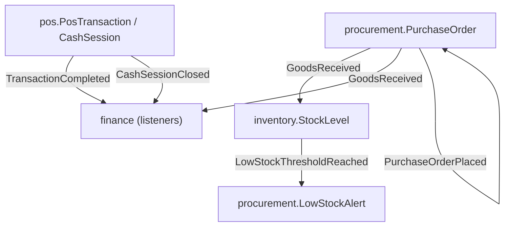

# Backend Class Diagrams

One file per business module.  
Each file contains: a Mermaid class diagram derived from the actual Java source, key constraints, business rules, and state machines where applicable.

| File | Module | Contents |
|---|---|---|
| [01-shared.md](01-shared.md) | `shared` | `Money`, `Quantity`, `UnitType`, `DomainEvent` |
| [02-auth.md](02-auth.md) | `auth` | `User`, `Role`, `AuthService`, first-admin flow |
| [03-inventory.md](03-inventory.md) | `inventory` | `ProductFamily`, `Product`, `StockLevel` aggregate, `LotEntry`, `Lot`, stock domain events |
| [04-pricing.md](04-pricing.md) | `pricing` | `ProductPrice`, `Promotion`, `PricingStrategy`, `PricingEngine` |
| [05-pos.md](05-pos.md) | `pos` | `Till`, `CashSession`, `PosTransaction` aggregate, `TransactionLine`, scanner pairing, POS events |
| [06-procurement.md](06-procurement.md) | `procurement` | `Supplier`, `PurchaseOrder` aggregate, `PurchaseOrderLine`, `LowStockAlert`, procurement events |
| [07-finance.md](07-finance.md) | `finance` | `JournalEntry` aggregate, `JournalLine`, `AccountCode`, `LedgerEntry`, `SupplierInvoice`, `SupplierPayment`, event listeners |

---

## Cross-module event map

| Event | Publisher | Consumer(s) | Result |
|---|---|---|---|
| `StockReceived` | `inventory.StockLevel` | — (internal only) | Lot added to stock |
| `StockSold` | `inventory.StockLevel` | — (internal only) | On-hand reduced |
| `StockWrittenOff` | `inventory.StockLevel` | — (internal only) | Lot quantity reduced |
| `LowStockThresholdReached` | `inventory.StockLevel` | `procurement` | `LowStockAlert` created |
| `TransactionCompleted` | `pos.PosTransaction` | `finance` | Sales/VAT/COGS journal posted |
| `CashSessionClosed` | `pos.CashSession` | `finance` | Cash deposit + variance journal posted |
| `GoodsReceived` | `procurement.PurchaseOrder` | `inventory`, `finance` | Lots created + GRNI journal posted |
| `PurchaseOrderPlaced` | `procurement.PurchaseOrder` | — (reserved) | — |

---

## Aggregate roots summary

| Module | Aggregate Root | Owns |
|---|---|---|
| `inventory` | `StockLevel` | `LotEntry` → `Lot` |
| `pos` | `PosTransaction` | `TransactionLine` |
| `procurement` | `PurchaseOrder` | `PurchaseOrderLine` |
| `finance` | `JournalEntry` | `JournalLine` |

All other entities (`Product`, `ProductFamily`, `Till`, `CashSession`, `Supplier`, `LowStockAlert`, `ProductPrice`, `Promotion`, `SupplierInvoice`, `SupplierPayment`, `LedgerEntry`, `User`) are independent entities accessed directly through their own repositories.

---

## Shared value objects embedded across modules

| Value object | Where used |
|---|---|
| `Money` (TND, 3 dp) | `Lot.unitCost`, `LotEntry.cost`, `CashSession.openingFloat/expectedCash/countedCash`, `TransactionLine.lineTotal/vatAmount`, `PurchaseOrderLine.unitCost`, `ProductPrice.unitPrice`, `JournalLine.debit/credit`, `SupplierInvoice.subtotal/taxAmount/total/paidAmount`, `SupplierPayment.amount`, `LedgerEntry.amount` |
| `Quantity` (EACH/WEIGHT) | `LotEntry.onHand/reserved`, `TransactionLine.quantity`, `PurchaseOrderLine.quantity` |
